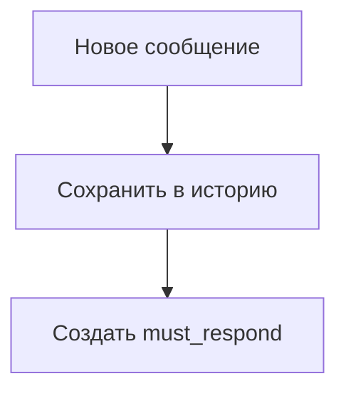
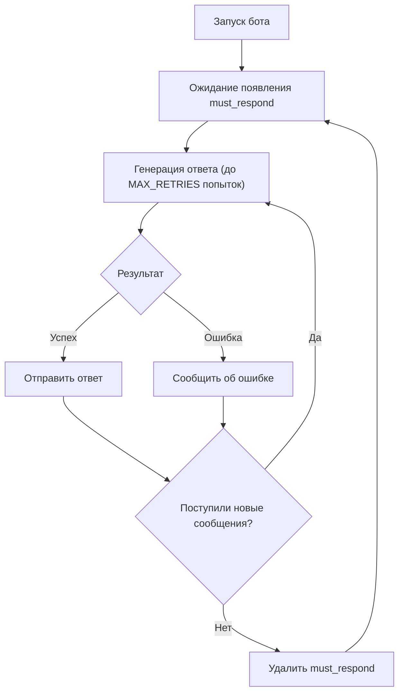

# Обработка сообщений и восстановление после сбоев

Бот отвечает на текст, изображения и голосовые сообщения.

Каждое сообщение сохраняется в истории и создаёт файл `must_respond`. Его содержимое — UTC timestamp в формате ISO 8601 с миллисекундами, например `2026-11-15T19:28:42.123Z`. Несколько сообщений подряд обрабатываются одним ответом, оставаясь отдельными `user`-сообщениями.

При перезапуске бот продолжает обработку незавершённых запросов.

Количество допустимых ошибок генерации задаётся переменной окружения `MAX_RETRIES=2`.

## Получение сообщений



## Цикл обработки



Перед запросом к API бот запоминает содержимое `must_respond`, а после ответа сравнивает его с текущим. Если за это время поступили новые сообщения, содержимое изменится и флаг останется для следующей обработки. Иначе бот удалит флаг.

# Файловая база данных

Все данные хранятся в `/db`. Каждый пользователь имеет собственный каталог.

## Структура

```text
/db/
├── config.json
├── agent.json
├── prices.tsv
├── user.default.json
└── users/
    └── 12345/
        ├── user.json
        ├── chat.json
        └── must_respond
```

- `config.json` содержит настройки бота.
- `agent.json` содержит модель, системный промпт приложения и параметры OpenAI Responses API.
- `prices.tsv` содержит тарифы моделей в USD за миллион токенов.
- `user.default.json` служит шаблоном нового пользователя.
- `user.json` содержит персональные настройки и баланс.
- `chat.json` содержит историю в формате OpenAI Responses API с автоматической очисткой старых сообщений.
- `must_respond` является файловым флагом необходимости ответа.

## Конфигурация

`config.json`:

```json
{
  "motd": "Привет! Я умный бот. Можешь писать мне, отправлять изображения и голосовые сообщения."
}
```

`agent.json` (сокращённый пример):

```json
{
  "model": "gpt-6-luna",
  "instructions": "Ты полезный ИИ-ассистент.",
  "reasoning": {
    "effort": "medium"
  },
  "max_output_tokens": 4096,
  "store": false
}
```

`prices.tsv`:

```tsv
model	input	cached	output
gpt-6-astra	10	1	50
gpt-6.1-sol	2	0.1	10
gpt-6.1-terra	1	0.05	5
gpt-6-luna	0.1	0.01	0.5
```

## Пользователи

`user.default.json`:

```json
{
  "credits": {
    "received": 100,
    "spent": 0
  },
  "usd": {
    "received": 0,
    "spent": 0
  },
  "system_message": "Отвечай дружелюбно и кратко."
}
```

При первом взаимодействии создаётся `/db/users/<id>/user.json` копированием `user.default.json`, независимо от типа сообщения или команды.

Баланс вычисляется как `credits.received - credits.spent`. Возможность отрицательного баланса пока не определена.

## История и системный промпт

`chat.json` хранит последовательность сообщений пользователя и ассистента. Старые сообщения удаляются при превышении лимита контекста.

Итоговые инструкции формируются объединением двух строк через `\n\n`:

```text
agent.instructions + "\n\n" + user.system_message
```

### **Команды бота**

| Команда    | Назначение                |
| ---------- | ------------------------- |
| `/start`   | Регистрация и приветствие |
| `/help`    | Справка по командам       |
| `/balance` | Баланс кредитов           |
| `/buy`     | Покупка кредитов          |
| `/reset`   | Сброс истории диалога     |

Команды обрабатываются локально. Кредиты расходуются только на ответы OpenAI API.

Единственный агент: `luna`. Смена агента не предусмотрена.
