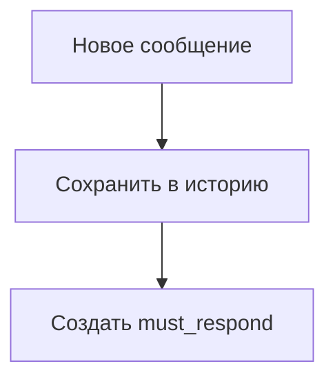
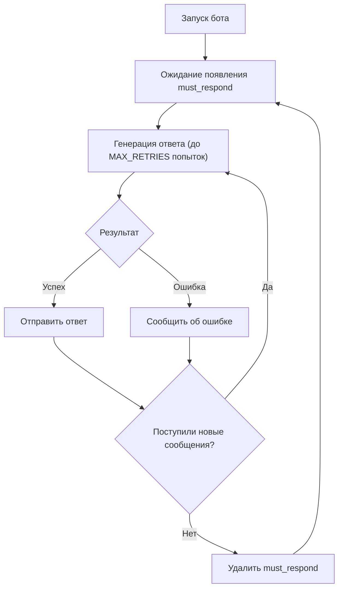

# Обработка сообщений и восстановление после сбоев

Бот отвечает на текст, изображения и голосовые сообщения.

Каждое сообщение сохраняется в истории и создаёт файл `must_respond`. Несколько сообщений подряд обрабатываются одним ответом, оставаясь отдельными `user`-сообщениями.

При перезапуске бот продолжает обработку незавершённых запросов.

Количество допустимых ошибок генерации задаётся переменной окружения `MAX_RETRIES=2`.

## Получение сообщений

## Цикл обработки

